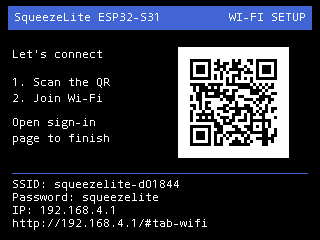
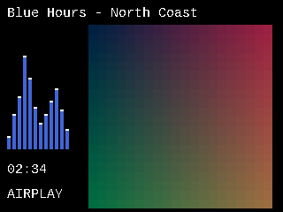

<h1 align="center">Squeezelite-ESP32 for ESP32-S31</h1>

<strong>More power. More audio features.</strong> 
Network audio, high-resolution playback and flexible DSP for the next RASPIAUDIO MnCast.

  <a href="https://apps.raspiaudio.com/"><strong>Install from your browser</strong></a> ·
  <a href="#easier-first-install">Easy setup</a> ·
  <a href="#three-ways-to-multiroom">Multiroom</a> ·
  <a href="#esp32-wrover-vs-esp32-s31">WROVER vs S31</a> ·
  <a href="#hardware-and-pinout">Pinout</a> ·
  <a href="#install-or-build">Install &amp; build</a>

An ESP32-S31 port of [Squeezelite-ESP32](https://github.com/sle118/squeezelite-esp32),
bringing more ways to listen, connect and shape your sound.

<table>
<tr>
<td width="50%" valign="top"><strong>Modern, high-quality Bluetooth audio</strong> 
LDAC and AAC reception, with SBC fallback. Playback validated with all three codecs.</td>
<td width="50%" valign="top"><strong>Native Gigabit Ethernet</strong> 
A direct RGMII connection between the S31 MAC and onboard YT8531 PHY for wired network audio.</td>
</tr>
<tr>
<td valign="top"><strong>High-resolution FLAC</strong> 
24-bit / 192 kHz playback validated over Ethernet with the external RASPIAUDIO Audio+ V3 DAC.</td>
<td valign="top"><strong>AirPlay 2</strong> 
An AirPlay 2 receiver with artwork support, plus a selectable legacy AirPlay 1 mode.</td>
</tr>
<tr>
<td valign="top"><strong>32-bit audio processing</strong> 
10-band equalizer, loudness and resampling on the PCM32 audio path.</td>
<td valign="top"><strong>Sendspin</strong> 
Music Assistant playback for your Home Assistant audio setup, with local connection and pairing controls.</td>
</tr>
<tr>
<td valign="top"><strong>Color display</strong> 
Album artwork, scrolling track information and optional animated spectrum bars, including standalone playback without LMS.</td>
<td valign="top"><strong>Easier first install</strong> 
On-screen Wi-Fi QR code and captive portal, or Improv Serial setup in the web installer after flashing.</td>
</tr>
</table>

See [validation status](#status) for tested configurations, AirPlay 2 qualification
and DSP workload limits. Gigabit is the [documented hardware interface](https://docs.espressif.com/projects/esp-dev-kits/en/latest/esp32s31/esp32-s31-function-coreboard-1/user_guide.html),
not a measured application throughput.

## ESP32-WROVER vs ESP32-S31

This compares the original ESP32-WROVER firmware at upstream `master-v4.3`
commit `ee1720c7556ffec5f43329aadd47c20546bdbb79` with this S31 port.
It compares those implementations, not everything that could be implemented on
either chip. The original firmware offers both 16-bit and 32-bit builds.

| Capability | Original ESP32-WROVER firmware | This ESP32-S31 port |
|---|---|---|
| **Bluetooth receive codecs** | **SBC** | **SBC + AAC + LDAC**, all three confirmed by listening |
| **FLAC sample rate** | Upstream documents up to **96 kHz** in both build modes | **192 kHz / 24-bit** playback validated over Ethernet with Audio+ V3 |
| **Audio precision** | 16-bit build truncates 24-bit sources; 32-bit build preserves up to 24-bit source depth | **32-bit PCM pipeline** preserving 24-bit source audio |
| **Equalizer with 24-bit audio** | Published capability table disables EQ in the 32-bit build; 16-bit EQ is limited to 48 kHz | **10-band EQ and loudness on PCM32**, filter tests through 192 kHz; combined-workload limits apply |
| **Resampling on PCM32** | Not available in the upstream 32-bit build | **libsoxr resampling on PCM32** for LMS playback, including tested conversions to/from 192 kHz |
| **Native Ethernet interface** | ESP32 MAC: **10/100 Mbit/s**, with an external PHY on boards that provide Ethernet | S31 MAC + onboard YT8531: **Gigabit Ethernet over RGMII** |
| **AirPlay** | AirPlay 1 | **AirPlay 1 + AirPlay 2**; Apple-device/multiroom qualification pending |
| **Sendspin** | Not included in this upstream baseline | **Music Assistant client**, pairing/playback tested, local web controls |
| **Wi-Fi onboarding** | Existing access-point/web setup | Adds **Improv Serial and QR-assisted captive portal** |

The demonstrated FLAC sampling rate is **twice the upstream documented ceiling**
(192 vs 96 kHz). Ethernet rates describe the hardware interfaces; there is no
claim of a tenfold measured streaming throughput or a measured CPU speedup.
The high-resolution result uses the external Audio+ V3, not the onboard ES8311.
Forced 176.4-to-192 kHz conversion with all DSP effects remains outside the
validated continuous-playback envelope; see [qualification limits](docs/STATUS.md).

Baseline sources: [upstream capability table](https://github.com/sle118/squeezelite-esp32/blob/ee1720c7556ffec5f43329aadd47c20546bdbb79/README.md),
[original SBC receiver](https://github.com/sle118/squeezelite-esp32/blob/ee1720c7556ffec5f43329aadd47c20546bdbb79/components/driver_bt/bt_app_sink.c#L330),
and [Espressif's ESP32 Ethernet specifications](https://documentation.espressif.com/esp32_datasheet_en.html).

## Three ways to multiroom

Choose the ecosystem that fits your home. The player includes clients for three
multiroom systems, each managing its own synchronized speaker groups:

| Ecosystem | How you use it |
|---|---|
| **Lyrion / LMS** | Group Squeezelite and Squeezebox players through Lyrion Music Server. |
| **Sendspin / Music Assistant** | Add the player to Music Assistant and manage playback and groups from your Home Assistant audio setup. |
| **AirPlay 2** | Use compatible Apple senders to select multiple AirPlay 2 receivers; Apple-device and multiroom qualification is still pending on this port. |

Sendspin pairing and playback with Music Assistant are tested. Multi-player
synchronization within each ecosystem is a separate qualification step and is
not yet claimed as validated for this port. See [validation status](docs/STATUS.md).

## Easier first install

**Flash → connect → listen.** Choose the Wi-Fi setup that suits your build.

Open **[apps.raspiaudio.com](https://apps.raspiaudio.com/)** in Chrome or Edge,
select **S31 → Squeezelite**, and connect your board by USB.
The webloader installs the firmware and offers Wi-Fi setup after flashing.

| On-screen QR code | Improv Serial over USB |
|---|---|
| **Scan and join** the player's setup Wi-Fi using the QR code displayed in fallback access-point mode. | **Flash and configure** without unplugging the board: choose **Configure Wi-Fi** in the compatible Chrome or Edge web installer. |
| **Enter your network credentials** in the captive portal. | **Select your network and enter its password**, then open the device URL. |
| Requires a connected, configured display. The setup SSID, password and URL stay visible in plain text. | No display required. Setup happens in the web installer; the player's local web interface becomes available once connected. |

If the captive portal does not open automatically, use the URL shown on screen.
**Prefer Ethernet?** Plug in the cable and open the player's local web interface.

  

<em>320 × 240 framebuffer preview of the Wi-Fi setup screen, with example credentials.
The layout was also validated on the physical ILI9341 display.</em>

The screen keeps the SSID, password, IP address and setup URL visible, with a
single QR code to join the setup network. See [display settings and rendering validation](docs/WIFI-SETUP-RENDERING.md).

## Install or build

- Install with the **[RASPIAUDIO webloader](https://apps.raspiaudio.com/)**,
  or download the [firmware binaries](firmware/experimental) and their checksums.
  The webloader has its own release cycle; see [installation details](docs/INSTALL.md).
- Follow [installation instructions](docs/INSTALL.md); **S31/16 MB only**.
- Compile using the pinned SDK and [fresh-clone build instructions](docs/BUILD.md).
- Review the successful [fresh-clone build verification](docs/BUILD-VALIDATION.md)
  and the [local review checklist](docs/REVIEW.md) before publication.
- Connect Ethernet, or configure Wi-Fi using Improv Serial or the fallback access point.
  The local web interface contains Services, Sendspin, audio, display and NVS settings.
  AirPlay 2 is enabled by default; disabling it selects the legacy AirPlay 1 receiver
  while the main AirPlay service remains enabled. Save and reboot to apply.

## Standalone now-playing screen

  

<em>320 × 240 production-renderer preview with synthetic artwork.
The animated bands were confirmed on the physical display on November 3, 2026.</em>

With a configured color LCD, standalone playback uses a large album-art area,
scrolling title/artist text and blue spectrum bars on a black background.
The bars are enabled by default and can be switched off in the local web
interface under **System → Now playing display**. This visual option does not
change audio equalization. Artwork availability still depends on the source;
Bluetooth artwork is not added by this feature.
See [layout, controls and validation](docs/STANDALONE-DISPLAY.md).

## Hardware and pinout

Test board: **Espressif ESP32-S31 Function-CoreBoard-1**, 16 MB flash / 16 MB PSRAM,
with YT8531 Ethernet, ES8311 codec and NS4150B speaker amplifier.
The default firmware uses the onboard audio: I2C SDA51/SCL50, I2S MCLK52,
BCLK53, LRCLK55, DOUT56, amplifier enable57. Numbers here are **GPIOs**.

Optional **RASPIAUDIO Audio+ V3** and **LCDwiki MSP2834 2.8-inch ILI9341 IPS**:

| Function | S31 GPIO / power | S31 J2 physical pin | Peripheral pin |
|---|---|---|---|
| Audio+ supply | 5 V | 39 | Audio+ 2 |
| Audio+ ground | GND | 38 | Audio+ 6 |
| Audio+ BCLK | GPIO48 | 14 | Audio+ 12 |
| Audio+ LRCLK | GPIO49 | 11 | Audio+ 35 |
| Audio+ data in | GPIO35 | 25 | Audio+ 40 |
| LCD supply | 3.3 V | 35 | LCD 1 / VCC |
| LCD ground | GND | 37 | LCD 2 / GND |
| LCD CS | GPIO40 | 19 | LCD 3 |
| LCD reset | GPIO43 | 17 | LCD 4 |
| LCD DC | GPIO42 | 20 | LCD 5 |
| LCD MOSI | GPIO39 | 21 | LCD 6 |
| LCD clock | GPIO38 | 22 | LCD 7 |

**J2 is not Raspberry Pi pin-compatible: do not stack the Audio+ directly.**
Use the Audio+ top male connector and the corrected [wiring drawing](docs/assets/cablage-audio-v3-s31-v2-corrige.png).
See [hardware settings and orientation](docs/HARDWARE.md) before changing the audio profile.
The LCD is used in landscape 320x240; touchscreen support is not qualified.

## Status

| Feature | Validation / limit |
|---|---|
| Native Gigabit Ethernet, Wi-Fi | Audio playback validated; Ethernet throughput not benchmarked at 1 Gbit/s; Wi-Fi 5 GHz / Wi-Fi 6 not qualified |
| FLAC 24-bit / 192 kHz | Validated on external Audio+ V3 with Ethernet; not a claim for the onboard ES8311 |
| 32-bit DSP | 10-band EQ, loudness and resampling implemented; see [limits](docs/STATUS.md) |
| Bluetooth Classic | SBC, AAC and LDAC playback validated |
| AirPlay 1 | Playback and artwork validated |
| AirPlay 2 | Software-sender protocol tests passed; Apple-device/multiroom qualification pending |
| Sendspin | Paired and tested with Music Assistant; local web settings included |
| Display | ILI9341 text/artwork validated; touchscreen deferred |
| Wi-Fi onboarding | Captive portal/QR and Improv Serial tested |
| Spotify Connect | Discoverable, but audio-key rejection remains unresolved; playback not validated |

## Development and review

This is the `s31` branch of the
[RASPIAUDIO fork](https://github.com/RASPIAUDIO/squeezelite-esp32), with complete
S31 sources, build instructions and firmware binaries. The original ESP32 branch
is retained as `master-v4.3`. See the [publication checklist](docs/REVIEW.md)
and [build verification](docs/BUILD-VALIDATION.md).

## Credits and licenses

Thanks to **Sébastien (sle118), Philippe (philippe44)**, the Squeezelite contributors,
emlynmac, Sendspin, Espressif and the codec/library authors. See [provenance](UPSTREAM.md)
and [third-party licenses](THIRD_PARTY_NOTICES.md). Original license notices are retained.
AirPlay 2 includes Rémi Bouteiller's `airplay-esp32` code under its own non-commercial
license; this repository does not relicense it or grant commercial permission.

