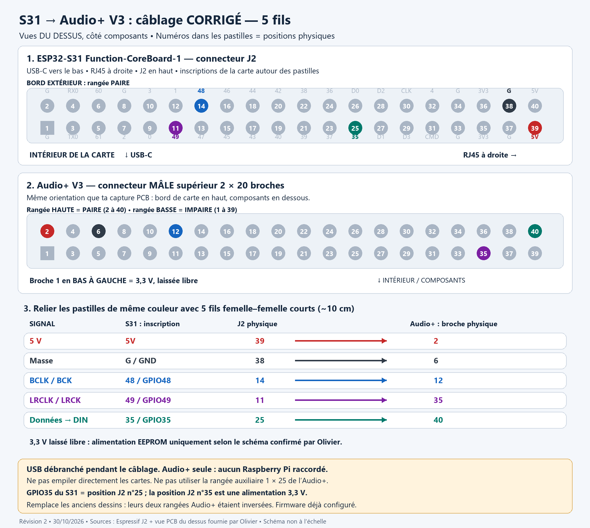
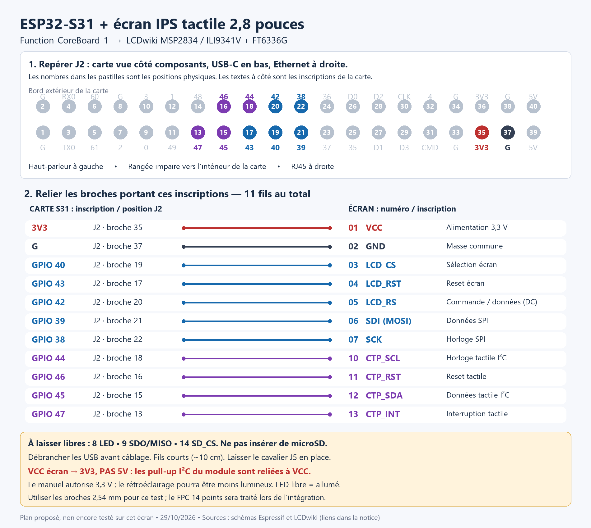

# Hardware profiles

Board: [ESP32-S31 Function-CoreBoard-1](https://docs.espressif.com/projects/esp-dev-kits/en/latest/esp32s31/esp32-s31-function-coreboard-1/user_guide.html), 16 MB flash / 16 MB PSRAM.
Only this board is the release target. J2 is not a Raspberry Pi HAT connector.

## Onboard audio (factory default)

`dac_config=model=ES8311,bck=53,ws=55,do=56,mck=52,sda=51,scl=50,i2c=24`

The NS4150B amplifier enable is GPIO57. This is the board speaker output;
external Audio+ stereo/high-rate results do not characterize this onboard codec.

## External Audio+ V3

`dac_config=model=i2s,bck=48,ws=49,do=35,mck=-1,sda=-1,scl=-1,mute=-1`

Use the five wires in the README. No MCLK wire or EEPROM connection is used.
The Audio+ 3.3 V EEPROM supply was not connected in the validated setup.
GPIO57/onboard amplifier should be disabled while using the external DAC.

On the Audio+ **top male header**, viewed from above with the board edge at the top,
the upper row is even (2...40), lower row odd (1...39); pin 1 is bottom-left.
Use the corrected drawing, not a mirrored underside connector view:



## LCD

[LCDwiki MSP2834](https://www.lcdwiki.com/2.8inch_IPS_SPI_Module_ILI9341), ILI9341,
240x320 pixels, used landscape 320x240, SPI2 at 10 MHz.
MOSI39/SCK38/DC42/CS40/RST43. Only the seven LCD wires in the README are needed.
The drawing also shows optional tactile wiring: **leave it disconnected** for this profile.
Leave LCD pins 8...14 disconnected. No microSD, no MISO, no backlight PWM.
Use 3.3 V for this documented module wiring, not a blanket 5 V substitution.

For this IPS panel, use `invert` in `display_config` in addition to `cswap`:

```text
SPI,width=320,height=240,cs=40,reset=43,speed=10000000,driver=ILI9341,cswap,invert
```

This selects the panel inversion command `0x21`, as specified in
[LCDwiki's ILI9341V initialization sequence](https://www.lcdwiki.com/res/MSP2833_MSP2834/ILI9341V_Init.txt).
It is a panel-specific setting, not a new default for every ILI9341 display.
If black backgrounds appear white and QR codes appear negative, check this setting.

The Wi-Fi setup screen uses a blue SqueezeLite ESP32-S31 header, a dark background, one
black-on-white Wi-Fi QR code, and plain-text SSID, password, IP and setup URL.
Credentials wrap within the screen margins; the QR retains a four-module quiet zone.
See [the renderer checks](WIFI-SETUP-RENDERING.md).



S31 component-side view, USB-C sockets down and RJ45 to the right: J2 is at the top,
even row toward the board edge, odd row inward. Physical pin 35 is 3.3 V;
it is not the pin marked GPIO35. Disconnect power before changing wiring.

