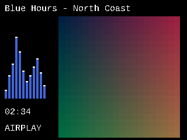

# Standalone now-playing display

The common player display can render a now-playing screen without an LMS server
or its display plugin. On the 320 x 240 ILI9341 it uses a black background,
white scrolling title/artist text, a 208 x 208 artwork area on the right, and
twelve blue spectrum bars with white peaks on the left. Playback has no brand
header. The time and source label sit below the spectrum.



This preview is rendered from the production GDS code with synthetic artwork;
it is not a photograph of the device.

## Setting

Open the player's local web interface, **System**, then **Now playing display**.
The **Enable animated spectrum bars (without LMS)** checkbox takes effect when
saved, without rebooting. It defaults to enabled and is persisted as the NVS
string `spectrum` (`Y` or `N`). Turning it off leaves the title and artwork in
place. This is a visual analyzer, not the audio equalizer: it does not alter
PCM samples, EQ, loudness, resampling or output precision.

The console equivalent is `cfg-syst-spectrum --enable` to enable, or
`cfg-syst-spectrum` to disable.

## Sources and limits

- AirPlay, Bluetooth and Sendspin use the common display when they own playback.
  They supply their existing metadata/artwork; this change does not invent
  album art or add Bluetooth Cover Art transport.
- Missing artwork falls back to the existing music-note image after five seconds.
- LMS retains its own display layout when it owns playback.
- Smaller or monochrome displays keep the original layout. The new layout
  requires an RGB565 framebuffer of at least 320 x 240 pixels.
- Spectrum updates are capped at 10 Hz. A bounded 512-frame, nonblocking snapshot
  is copied from the I2S output; analysis runs on the display task, not the audio
  thread. High-rate samples are averaged for display analysis only.
- The old 500 ms output-buffer gate is removed from the I2S visualization tap:
  low-latency receivers such as AirPlay 2 keep a much smaller downstream queue.
- Channel powers are combined independently so opposite-phase stereo does not
  incorrectly disappear from the display.

## Validation

Run with Clang and Python with Pillow:

```sh
python scripts/tests/test_standalone_display.py --out /path/to/test-output
```

The host harness uses the actual renderer, font/drawing code, ILI9341 transfer
code, PCM collector and spectrum implementation. Only the DSP backend is replaced
by a host DFT. Checks cover 320 x 240 and 480 x 320 bounds, artwork preservation,
long text, disabling bars, restored font state and panel transfers. PCM16/PCM32
checks cover fragmented writes, opposite-phase tones and silence/stale decay at
44.1, 48, 96 and 192 kHz. These do not qualify acoustic output or hardware
performance at all those rates.

## Device checks — 2026-11-02

Test board: ESP32-S31 Function-CoreBoard-1, ILI9341 320 x 240 over SPI,
Ethernet active, local Windows LMS service stopped. Application-only flash
was verified by esptool. Version: `s31-standalone-20261102`.

- Encrypted AirPlay 2 ALAC test, 48 seconds of audio: 6,202 packets decoded,
  8,732,416 PCM bytes, matching sender XOR/sum (`a1b7a1dd` / `6b5e23ab`).
  Periodic receiver statistics reported zero dropped packets, decrypt errors,
  underruns, overruns, late packets and short writes during this run.
- Device log confirmed the 208 x 208 layout and live 44.1 kHz, twelve-band PCM
  analysis. An earlier version had static bars because of the 500 ms gate;
  that gate was removed before this final run.
- The web command descriptor exposes the checkbox. API save/readback passed
  for both states. Disabled state survived a reboot; enabled state was restored.
- All ten host cases passed (two display sizes plus eight PCM depth/rate cases).
- Physical confirmation of the final bar animation is still pending. This
  short run is not a new endurance, Bluetooth, Sendspin or high-rate qualification.
  The browser-control runtime was unavailable; web validation used the actual
  device API and the existing generic form-generation code, not a browser click test.

Application SHA-256:
`3cec796006be3ce24a1119d96a764a1df30128aec97c1c7e2d1fbba33e826dd1`.

The existing packaged release binaries and webloader are not replaced by this
development test. No private configuration or raw serial logs are included here.
